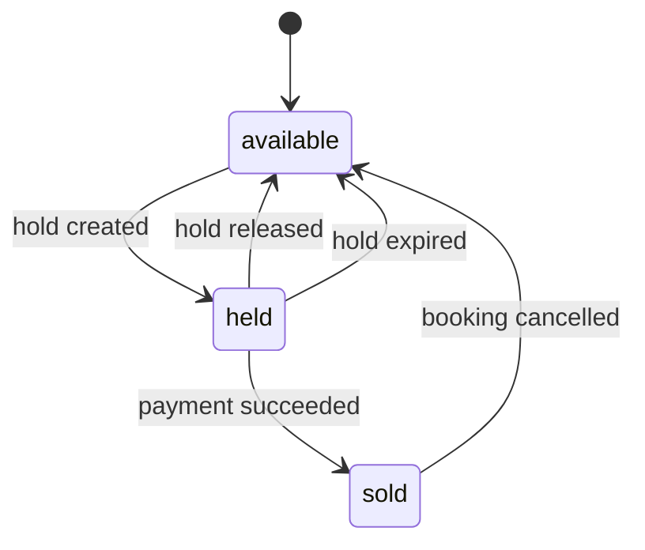
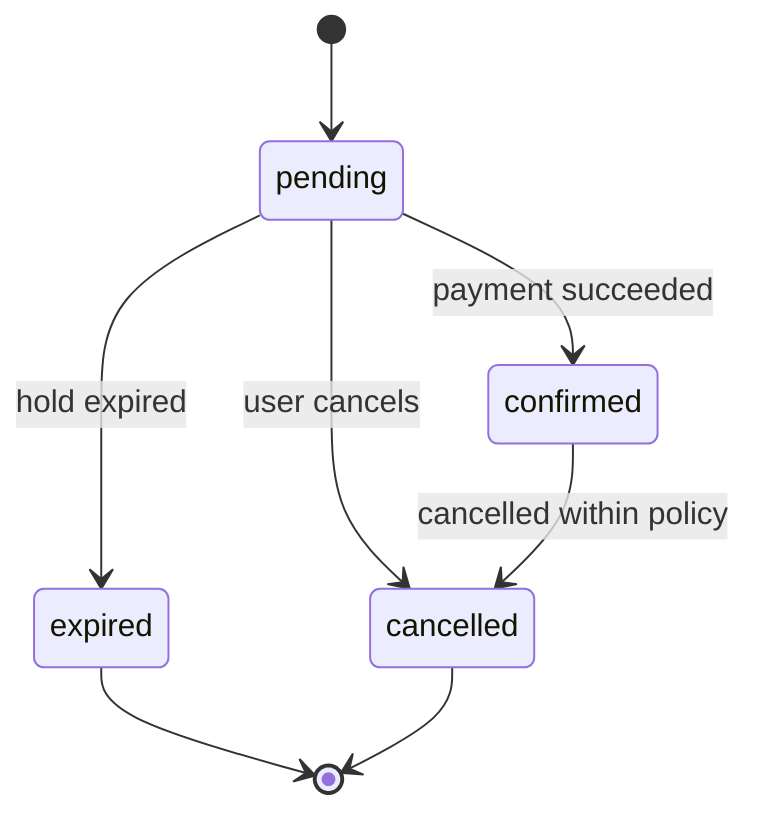

# Booking and Seat Hold Lifecycle (Contract Level)

> Status: **draft v0.1**, pending agreement from Phong (M2).
> Author: Viet (M1). Inputs: meeting notes of 18/11/2026, `docs/api/api-conventions.md`.
> This document defines states, transitions and the API call or event that causes each transition. It does not define implementation. If this file and `api-conventions.md` disagree, fix both before merging.

## 1. Entities and states

| Entity | States | Terminal states |
|---|---|---|
| Seat (per showtime) | `available`, `held`, `sold` | none (a seat can return to `available`) |
| Booking | `pending`, `confirmed`, `cancelled`, `expired` | `cancelled`, `expired` |

Payment (`processing`, `succeeded`, `failed`) is a sub-state of a booking and does not change the booking state by itself, except `succeeded`.

## 2. Seat state diagram

| # | From | To | Event | Triggered by |
|---|---|---|---|---|
| S1 | `available` | `held` | Seats held (all or nothing) | `POST /showtimes/{showtimeId}/holds` |
| S2 | `held` | `available` | User goes back and releases the hold | `DELETE /holds/{holdId}` (proposed) |
| S3 | `held` | `available` | Hold reaches `expiresAt` with no successful payment | System job (UC22), no API call |
| S4 | `held` | `available` | Booking becomes `cancelled` or `expired` while pending | Side effect of B3 or B4 |
| S5 | `held` | `sold` | Verified payment webhook, booking becomes `confirmed` | Payment service webhook to core (server-to-server) |
| S6 | `sold` | `available` | Booking cancelled within policy | `POST /bookings/{bookingId}/cancellation` |

Rules:
- `available` to `sold` directly is not allowed. Every sale goes through `held`.
- A hold is all or nothing: if any seat conflicts, none is held (`409 SEAT_ALREADY_HELD`).
- Couple seats change state together as one unit.
- Seat state is per showtime, not per screen.

## 3. Booking state diagram

| # | From | To | Event | Triggered by |
|---|---|---|---|---|
| B1 | (none) | `pending` | Booking created from a valid hold; the hold deadline is not extended | `POST /bookings` |
| B2 | `pending` | `confirmed` | Payment succeeded (verified webhook, not replayed) | Payment webhook to core |
| B3 | `pending` | `cancelled` | User abandons before paying | `POST /bookings/{bookingId}/cancellation` |
| B4 | `pending` | `expired` | `paymentDueAt` (= hold `expiresAt`) passed | System job (UC22) |
| B5 | `confirmed` | `cancelled` | Cancellation allowed by policy (before deadline, not checked in) | `POST /bookings/{bookingId}/cancellation` |

Rules:
- A failed payment does not change the booking: it stays `pending` while the hold is valid, and the user may retry with a new `Idempotency-Key` (`POST /bookings/{bookingId}/payments`).
- The frontend never sets `confirmed`. It only reads the state with `GET /bookings/{bookingId}`.
- Cancellation outside policy returns `422 CANCELLATION_NOT_ALLOWED`.
- Creating a booking from an expired hold returns `409 HOLD_EXPIRED`.

## 4. Combined timeline (guest books 2 seats)

| Step | API | Seat | Booking |
|---|---|---|---|
| Choose seats, click Continue | `POST /showtimes/{id}/holds` | `available` to `held` | none |
| Enter details | `POST /bookings` | `held` | `pending` |
| Pay | `POST /bookings/{id}/payments` | `held` | `pending` |
| Webhook success | payment service to core | `held` to `sold` | `pending` to `confirmed` |
| Or: time runs out | system job | `held` to `available` | `pending` to `expired` |
| Or: cancel after paying | `POST /bookings/{id}/cancellation` | `sold` to `available` | `confirmed` to `cancelled` |

## 5. Open questions

1. **When the hold timer starts.** This document assumes the hold starts when seats are chosen (5 minutes, `HOLD_TTL_SECONDS=300`). The meeting notes can also be read as "starts when the user clicks pay". Phong and the team must confirm.
2. **Payment success after expiry.** If the webhook says `succeeded` after the booking is `expired`, the booking stays `expired` and the payment service must refund. Viet to specify in the payment contract.
3. **Cancelling a `pending` booking (B3).** Keep it, or let the user simply release the hold (S2) and let the booking expire?
4. **Refund on B5.** Who calls the payment service and in what order (refund first, then release seats)? Phong and Viet.
5. **Ticket status.** Check-in needs a ticket status (`valid`, `used`) separate from booking and seat states. To be defined by Khanh Le.
6. **Naming.** `pending`/`sold` (this file) versus `pending_payment`/`booked` (`api-conventions.md`).